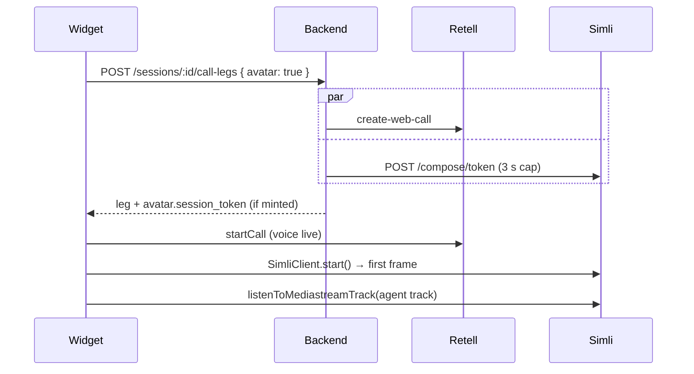

# 13 — Avatar

Part of [the spec](./README.md). Decided on
[the avatar map](../wayfinder/avatar/map.md). Every decision below links to the ticket that
argued it.

An animated, lip-synced face at the top of the widget panel during a call. It is an
**optional layer**: when it is off, refused or broken, the widget is exactly today's
voice-only experience. Desktop only ([mobile is out of scope](../wayfinder/avatar/tickets/009-mobile-avatar-support.md)).

## The rules

> **Voice never waits for, depends on, or is degraded by the avatar.**
> **The Simli API key never reaches the browser.**
> **The avatar is always the first thing dropped.**

## Vendors

| | Role | Fixed? |
| --- | --- | --- |
| Retell | The voice. It plays the agent's audio. | Yes |
| Simli (`simli-client` in the browser) | Video only. Its audio is muted. | No: replace it if it disappoints |

Simli free tier: 50 min a month, **1 concurrent session**, template faces only. A second
shopper on the store at the same time gets no avatar; that is a known limit
([ticket 007](../wayfinder/avatar/tickets/007-avatar-cost-guardrails.md)).

## Architecture

Decided in [ticket 002](../wayfinder/avatar/tickets/002-avatar-integration-architecture.md);
the audio tap was corrected by the [go/no-go prototype](../wayfinder/avatar/tickets/003-avatar-go-no-go-prototype.md).



### Audio tap

- The call leg uses Retell's **`gateway`** transport.
- Take the agent's track from the transport's private `RTCPeerConnection`: the first `kind ===
  'audio'` track from `pc.getReceivers()`. Pass it to `simli.listenToMediastreamTrack(track)`.
- This reaches into SDK internals, the same way `VoiceClient.#applyAgentMute` already does.
  It ties us to `retell-client-js-sdk` 3.x and its `RetellWebClient`.
- Simli options:
  - `handleSilence: false`
  - `audioBufferSize: 800`
  - transport `livekit`
- **Mute Simli's `<audio>` element.** Retell's playback is untouched.

## Changes per package

| Package | Change |
| --- | --- |
| `theme` | An "Enable avatar" checkbox in the `wayfinder-widget` section schema. Liquid sets `window.__WAYFINDER__.avatar = true` when it is on. |
| `widget` | A new `avatar.ts`, which loads `simli-client` lazily (esbuild code splitting). Includes the portrait markup, the avatar button, and the hidden flag. |
| `backend` | A new `avatar/` module with an `AvatarProvider` interface (mirroring `voice/voice-provider.ts`) and a Simli implementation. Changes the call-leg route and adds a mid-leg token route. |
| `contracts` | Zod schemas for the call-leg response, including the optional `avatar`, and for the mid-leg token response. |

## Configuration

[Ticket 005](../wayfinder/avatar/tickets/005-simli-credential-handling.md).

| Env var | Required | Effect if missing |
| --- | --- | --- |
| `SIMLI_API_KEY` | No | Avatar off: no `avatar` field on any call leg, and no error |
| `SIMLI_FACE_ID` | No | Same |

The avatar is on only when **both** the merchant's checkbox is on and both env vars are set.

## Contracts

The call-leg request body gains `avatar?: boolean`. The widget sends it when
`__WAYFINDER__.avatar` is set and the shopper hasn't hidden the avatar.

The call-leg response gains:

```ts
avatar?: { session_token: string }
```

If the field is absent, that Call Leg is voice-only. The widget must not treat a missing field as
an error.

`POST /sessions/:id/avatar-token` returns `{ session_token: string }`.

## Backend

### Minting

- Call `POST https://api.simli.ai/compose/token` with header `x-simli-api-key`, **in parallel**
  with Retell's `create-web-call`, with a **3 s cap**.
- If it times out or fails, the leg still succeeds without `avatar`. Log the error code.
- Token config:
  - `faceId`
  - `handleSilence: false`
  - `maxSessionLength: 600`
  - `maxIdleTime: 30`
- **Out of minutes:** when Simli returns its "no minutes left" error, set an in-memory flag
  and skip minting for **1 hour** ([ticket 007](../wayfinder/avatar/tickets/007-avatar-cost-guardrails.md)).

### Mid-leg token route

`POST /sessions/:id/avatar-token`

- Requires `x-wayfinder-session-token` and a live Call Leg.
- Rate limit: **1 per Session every 10 s**. Return 429 above that.
- Used only to show the avatar again after hiding it, and for the one retry when the slot is
  still held (below).

### Secrets

- Never log the API key or any session token. Log error codes only.
- The key lives only in the Render env and a gitignored `.env`.

## Widget lifecycle

[Ticket 004](../wayfinder/avatar/tickets/004-avatar-lifecycle-across-page-loads.md).

| Event | Avatar does |
| --- | --- |
| A Call Leg starts (initial or reconnect) | After `voice.start(leg)` resolves, if `leg.avatar` exists: load `avatar.ts`, `new SimliClient(...)`, `start()`, then attach the tap |
| `start()` refused because the slot is still held | Retry once after about 2 s with a fresh token from the mid-leg route, then go voice-only for this leg |
| The agent is silent | Keep running (a restart costs 2–2.7 s) |
| `pagehide` | Fire-and-forget `simli.stop()` in the existing handler. `maxIdleTime: 30` is the backstop |
| The call ends (`onEnd` / `call_ended`) | `simli.stop()` |
| The shopper hides the avatar | `simli.stop()` and set `sessionStorage['wayfinder:avatar-hidden'] = '1'` |
| The shopper shows it again | Clear the flag, get a token from the mid-leg route, and start |
| The hidden flag is set at leg start | Send `avatar: false` (or omit it). No token is minted and no session starts |
| `maxSessionLength` is reached | Simli stops; voice carries on; the shopper can show the avatar again |
| Any Simli `error` or `startup_error`, or a timeout | Failed state (below). Voice is untouched |

Measured in the prototype: 0.5–0.65 s to mint a token, then 1.3–2.2 s to the first frame,
**2.0–2.7 s in total**. `stop()` takes about 70 ms and frees the slot in time for an
immediate restart.

## Visuals

[Ticket 006](../wayfinder/avatar/tickets/006-avatar-visuals-and-failure-states.md). Prototype:
[006-avatar-visuals](../wayfinder/avatar/prototypes/006-avatar-visuals/index.html).

- **Placement:** a square, full-width portrait under `panel-header`, with rounded corners.
  While the avatar is shown, it replaces `waveform-container`.
- **No layout jump.** The portrait space is the same size in every state except hidden.

| State | Portrait shows |
| --- | --- |
| Starting | A still of the face, a small spinner, and a "CONNECTING" label |
| Idle / speaking | The live video |
| Failed | The face greyed out, with a "VOICE ONLY" label |
| Hidden | No portrait. Today's voice-only layout, with the waveform |

- **Subtitles:** stay below the portrait, unchanged.
- **Avatar button:** a new `control-btn avatar-btn` in `control-buttons-group`, after
  `subtitles-btn`. It reuses `bindToggle`'s `is-off` / `aria-pressed` pattern with the
  `wayfinder:avatar-hidden` key. Labels: "Hide avatar" and "Show avatar".
- The video element is muted and uses `playsinline`, so autoplay needs no gesture.

## Known limits

- Lip sync is imperfect: the lips lag Retell's audio by Simli's processing delay. This was
  accepted at go/no-go.
- The exact lag was not measured: in the prototype, Retell's gateway client emitted no
  `agent_start_talking` and Simli emitted no `speaking`.
- **Billing granularity is unknown:** Simli doesn't document whether minutes are rounded, or
  whether idle time is billed.
- Retell SDK 4.0 removes `RetellWebClient`. Upgrading means re-checking the audio tap.
