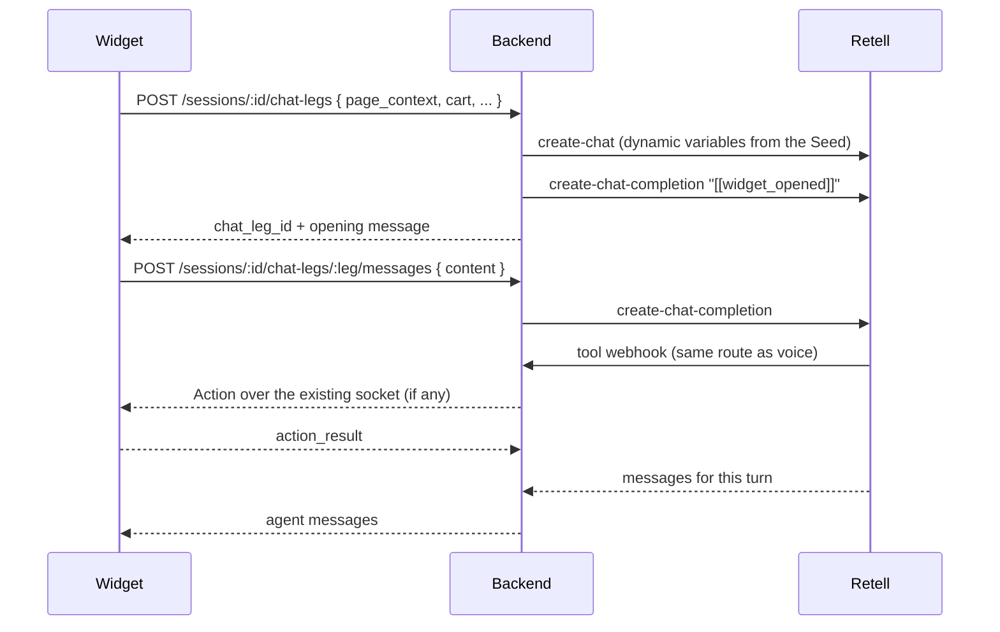

# 14 — Chat mode

Part of [the spec](./README.md). Decided in conversation on 2026-11-12; no wayfinder map.
Retell API facts were checked against the Retell docs on the same date.

A text chat version of the assistant that runs alongside voice in the same widget. **Chat is the
default**; a toggle switches to voice. The agent, its tools, the Actions, the preview panel and
continuity across page loads all behave the same in both modes. Only the channel changes.

## The rules

> **One prompt source, one tool source.** Chat and voice are generated from the same files and
> the same contracts; nothing is copied by hand.
> **Toggling mode starts a fresh Session.** Nothing carries across modes.
> **Within a mode, a conversation survives page loads** ([ADR-0001](../adr/0001-reconnect-with-replay-voice-continuity.md)).

## Decisions

| # | Decision |
| --- | --- |
| 1 | Engine: a **Retell chat agent** with its own Retell LLM. Not a direct LLM integration. |
| 2 | **Default mode is chat.** The chosen mode is kept in `sessionStorage` (`wayfinder:mode`), so a voice shopper stays in voice across page loads. |
| 3 | **Toggling ends the current Session** (and any live call or chat) and starts a new one in the other mode. |
| 4 | Search results show as tiles in the **same preview panel** as voice, including the **tile highlight** when a product is named. |
| 5 | Messages render in the **existing subtitle container** (`.transcript-preview`). The **text input sits below it**. |
| 6 | The **mode toggle sits next to the mic and subtitles buttons**. |
| 7 | In chat mode the **mic button, subtitles button and avatar are hidden**. |
| 8 | The agent **opens every chat with a greeting**, as voice does. |
| 9 | After a page load the agent **posts a new message**. Earlier messages are **not redisplayed**; the agent still knows them through the Seed. |
| 10 | If the panel is closed when the agent posts after a page load, **the panel opens**. |

## Retell chat API

| Call | Use |
| --- | --- |
| `POST /create-chat` `{ agent_id, metadata, retell_llm_dynamic_variables }` | Start a Chat Leg. Same dynamic variables as a Call Leg. |
| `POST /create-chat-completion` `{ chat_id, content }` | Send one shopper message. **Synchronous**: returns every new message from that turn, including tool invocations and results, once the turn is complete. **No streaming.** |
| `PATCH /end-chat/{chat_id}` | End a Chat Leg. |

Chat agent settings that matter (all set by sync, not the dashboard):

- `response_engine` → the chat LLM.
- `post_chat_analysis_model` → **defaults to `gpt-5.6-terra`**. Set it to the same cheap model
  as the agent, or leave analysis off.
- `end_chat_after_silence_ms` → `120000` (the minimum) as a backstop for abandoned legs.
- `data_storage_setting`, `data_storage_retention_days`, `pii_config` → the same values as
  voice (`RETELL_DATA_STORAGE`).

### Verified by spike C1 (2026-11-12)

1. **Tool webhook body.** `{ chat, name, args }`: the same shape as voice, with **`chat` in
   place of `call`**. `chat.metadata` carries `session_id` and `chat_leg_id` as passed to
   `create-chat`. `X-Retell-Signature` is present; verification is unchanged.
2. **Opening message.** A chat agent does **not** open on its own, even with
   `start_speaker: 'agent'`; `create-chat` returns no messages. The backend therefore opens
   every Chat Leg by sending the fixed trigger **`[[widget_opened]]`** as the first
   completion. `20-chat.md` tells the agent this means the widget opened and to greet or resume.
   The trigger is never shown in the widget and never recorded in `session.transcript`.
3. **Cost.** Billed **per completion**: `gpt-5.4-mini` was 0.75¢ per completion (a tool call
   within a turn did not add a second charge). **Post-chat analysis is billed per chat** at
   2.08¢ on the default `gpt-5.6-terra`. With one chat per page load, that charge repeats on
   every page, so sync **must** set `post_chat_analysis_model` to the cheap model or turn
   analysis off. No `llm_token_surcharge` appeared, but the test prompt was tiny; recheck with
   the real prompt after C3.
4. **Latency.** `create-chat` ~0.3 s. Completion ~1.6–1.8 s without a tool, ~3.6 s with one
   tool call.

## Architecture

A **Chat Leg** is the chat equivalent of a Call Leg: one Retell chat per page load, belonging to
a Session and seeded the same way.

- **Tools and Actions are unchanged.** Retell calls the same `/webhooks/retell/tool` route; the
  backend dispatches exactly as for voice, and Actions still reach the browser over the
  `/sessions/:id/socket` WebSocket.
- **The widget never talks to Retell.** The API key stays on the server; every Retell call is
  made by the backend.
- **The transcript is recorded by the backend**, from the completion responses. Chat needs no
  `pagehide` beacon.
- **Leaving the page mid-turn.** If an Action navigates, the page unloads before the
  completion returns, so that reply is never shown. The backend still records it, and the next
  page's Chat Leg opens with `resumed_after_your_navigation`. This matches decision 9.
- **One turn at a time.** The input is disabled while a completion is pending; the backend
  rejects a second message on the same leg with `409`.
- **Ending legs.** Creating a new Chat Leg ends the previous one. `DELETE /sessions/:id` ends the
  active leg.

## Changes per package

| Package | Change |
| --- | --- |
| `contracts` | Schemas for the chat-leg request (same body as the call-leg request) and response, the message request (`content`, max 1,000 chars) and response (`messages: { role: 'agent', text }[]`). A `Channel` enum: `chat`, `voice` (not `SessionMode`, which is standby/live). |
| `retell` | `buildPrompt(mode)`: `20-voice.md` is voice-only; a new `20-chat.md` holds the chat rules. Sync pushes a second LLM and the chat agent. Chat tools use no `speak_during_execution`. |
| `backend` | A `ChatProvider` interface beside `VoiceProvider`, with a Retell implementation. The two chat-leg routes. The tool webhook accepts the chat payload shape (C1). Config reads `RETELL_CHAT_AGENT_ID`. |
| `widget` | Mode state and toggle. Chat UI in the subtitle container plus the input. Hiding voice-only controls. The chat flow, including `preview.follow()` on each agent message. |
| `theme` | Markup for the input and the toggle in the widget snippet, if the widget does not render them itself. |

## Prompt

- Shared: `10-identity.md`, `30-guardrails.md`, `40-continuity.md`, the generated tool text and
  the Session brief.
- Voice only: `20-voice.md`.
- Chat only: `20-chat.md` — short written replies, plain text (no markdown, since the subtitle
  container renders text), name each product you describe so its tile lights up, and the same
  greeting and resumption rules.

## Widget

- **Mode.** `wayfinder:mode` in `sessionStorage`; absent means `chat`.
- **Chat layout.** `.transcript-preview` always visible and showing this leg's messages, both
  shopper and agent. The input and send button sit below it. The mic button, subtitles button
  and avatar are hidden.
- **Voice layout.** Unchanged from today.
- **Toggle.** Next to the mic and subtitles buttons, visible in both modes. On toggle: end the
  Session (`DELETE /sessions/:id`), clear `wayfinder:session`, set `wayfinder:mode`, then start
  in the new mode.
- **Page load in chat mode.** If a Session exists, create a Chat Leg, open the panel if it is
  closed, and show only its opening
  message. Chat needs no mic permission, so it always resumes.
- **Highlight.** Call `preview.follow(text)` once for each agent message. Replies arrive whole,
  so the highlight lands on the last product named in the message.
- **Pending state.** A typing indicator in the thread while a completion is pending.

## Configuration

| Variable | Lives in | Used by |
| --- | --- | --- |
| `RETELL_CHAT_AGENT_ID` | GitHub secrets, Render, `.env` | Sync (agent update) and the backend (`create-chat`) |
| `RETELL_CHAT_LLM_ID` | GitHub secrets, `.env` | Sync (LLM update) |

Already provisioned. Section 08's secrets table needs both rows, and its `RETELL_AGENT_ID` row
should also list Render (the backend already reads it).

## Security

- Chat routes are authorised by the Session token, like every other Session route.
- The message route caps `content` at 1,000 characters and is rate-limited per Session.
- Message text is rendered as text (`textContent`), never as HTML.

## Not decided

- **Switching to voice.** Whether the call starts at once on toggle or waits for the shopper to
  press the mic button, as today. Default for the build: wait.

## Tasks

[`docs/tasks/chat/`](../tasks/chat/).
